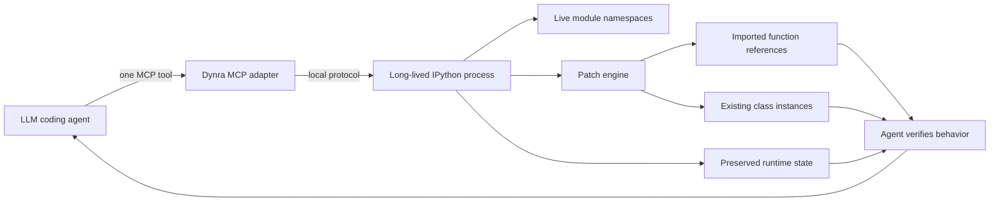

<p align="center">
  
</p>

<p align="center">
  <strong>Live Python runtime for LLM coding agents.</strong><br>
  Inspect, patch, and verify running software without restarting the process or losing its state.
</p>

<p align="center">
  <code>Python 3.10+</code> · <code>Model Context Protocol</code> · <code>State-preserving patches</code> · <code>IPython runtime</code>
</p>

<p align="center">
  <a href="https://deepwiki.com/antlobach/Dynra"></a>
</p>

## Give coding agents a live Python process

Most coding agents work indirectly: edit files, restart Python, reconstruct fixtures, reproduce the bug, and repeat. Every restart discards useful runtime context—loaded data, object graphs, caches, active sessions, and the exact state that exposed a failure.

Dynra gives an LLM coding agent a persistent Python runtime it can operate through MCP:

1. **Inspect** live modules, objects, and behavior.
2. **Patch** a function or class inside its owning module.
3. **Verify** the change against the already-running scenario.
4. **Iterate** without rebuilding state after every hypothesis.

Dynra is not a file watcher that restarts Python. It is a **state-preserving live programming runtime built for agentic development**.



## Agent quick start

Clone Dynra, then start it from the target project's root with the target
project's interpreter:

```bash
git clone https://github.com/antlobach/Dynra.git /path/to/Dynra
cd /path/to/target-project
uv sync
uv pip install --python .venv/bin/python /path/to/Dynra
.venv/bin/dynra
```

Starting at the target root is significant. Dynra reads `pyproject.toml`, recognizes
conventional and configured source roots such as `src/`, and indexes project modules
without importing them.

Configure Dynra in an MCP-compatible coding agent, replacing the path with your clone:

```json
{
  "mcpServers": {
    "dynra": {
      "command": "uv",
      "args": [
        "--directory",
        "/absolute/path/to/Dynra",
        "run",
        "python",
        "dynra_mcp.py"
      ]
    }
  }
}
```

The MCP adapter connects to the running process at `127.0.0.1:9999`.

## One MCP tool

Dynra exposes one general interface:

```text
dynra_repl(code, module="user", create=False)
```

The agent uses the same tool to inspect state, reproduce behavior, redefine functions
or classes, and verify results. `module` selection is atomic. Imports are strict:
missing modules and import-time dependency failures are returned as errors. Set
`create=True` only when intentionally creating a synthetic scratch module. The
response contains `success`, `module`, `result`, `stdout`, `stderr`, and `error`.

## A complete agent live-coding loop

Assume an agent is debugging pricing behavior. It creates a live library module:

```text
dynra_repl(
  module="pricing",
  code="def price(sku):\n    return {'book': 20}[sku]",
  create=True,
)
```

It creates a consumer with state and an imported function reference:

```text
dynra_repl(
  module="checkout",
  code="from pricing import price\ncart = ['book']\ndef total():\n    return sum(price(sku) for sku in cart)",
  create=True,
)

dynra_repl(module="checkout", code="total()")
# result: "20"
```

The agent patches only the behavior it is investigating:

```text
dynra_repl(
  module="pricing",
  code="def price(sku):\n    return {'book': 25}[sku]"
)
```

Then it verifies the already-running scenario:

```text
dynra_repl(module="checkout", code="total(), cart")
# result: "(25, ['book'])"
```

`checkout.price` was imported before the edit, but Dynra updated that existing function reference. The cart and its surrounding runtime stayed alive. The agent tested a hypothesis without recreating the process.

## Why this helps LLM agents

- **Less setup repetition:** expensive datasets, fixtures, and application state remain loaded.
- **Faster hypothesis loops:** one REPL tool handles inspection, patches, and verification.
- **Better runtime grounding:** the agent observes actual objects and behavior instead of inferring everything from source.
- **Stateful debugging:** failures that emerge after many transitions can remain reproduced while logic changes.
- **Smaller changes:** an agent can patch one definition, verify it, and only then persist the proven source edit.
- **Cross-module fidelity:** previously imported function references receive compatible live updates.

A useful agent operating pattern is:

```text
inspect live state -> reproduce failure -> patch owning module
-> verify observable behavior -> persist proven source change
```

Dynra is a runtime laboratory, not a replacement for source control or tests. A successful live patch proves behavior in the current process; the agent should still write the final source change and run the relevant durable checks.

## Runtime model

- One long-lived IPython process owns the live state.
- Project modules are discovered statically from the repository and `pyproject.toml`.
- `require_md(name)` imports an existing namespace and preserves import errors.
- `create_md(name)` explicitly creates a synthetic namespace.
- `in_md(name)` enters an existing real or synthetic namespace.
- Remote evaluations reconcile each top-level definition before evaluating the next
  statement.
- Compatible function and class redefinitions retain one canonical object identity.
- Existing instances can migrate state through `__dynra_update__`.
- Re-evaluating an existing decorated definition updates its body without running its
  registration decorators again.
- A refused definition in a multi-definition evaluation rolls the definition changes
  back as a unit.
- Imported application modules are not populated with Dynra command names; commands
  are supplied through the REPL builtins.

## Class evolution

An agent can include an instance migration hook when a new definition needs additional state:

```python
class Session:
    def __init__(self, user):
        self.user = user

    def label(self):
        return f"{self.user}:{self.status}"

    def __dynra_update__(self):
        if not hasattr(self, "status"):
            self.status = "active"
```

After a compatible patch, existing `Session` instances receive the new method and run `__dynra_update__`.

## Human interfaces

Dynra includes:

- `dynra_client.py` for one-off terminal evaluations.
- `dynra_extension.py` for IPython integration.
- A direct interactive REPL through `uv run dynra`.

`dynra_client.py` can select a namespace atomically:

```bash
python /path/to/Dynra/dynra_client.py --module package.module "expression"
python /path/to/Dynra/dynra_client.py --module scratch --create "value = 1"
```

Runtime commands:

| Command | Purpose |
| --- | --- |
| `create_md(name)` | Explicitly create a synthetic REPL module. |
| `require_md(name)` | Import a real module and surface its complete import error. |
| `in_md(name)` | Enter an existing real or synthetic module. |
| `ls_md()` | Separate discovered, loaded-project, synthetic, and external modules. |
| `dir_md(module=None)` | List symbols, including static inspection of unloaded project modules. |
| `doc(obj)` / `source(obj)` | Show documentation or live source. |
| `find_var(pattern)` | Search loaded modules for matching symbol names. |
| `function_patch_mode(mode=None)` | Read or set `safe` / `permissive` function patching. |
| `class_patch_mode(mode=None)` | Read or set `safe` / `permissive` class patching. |
| `unmap(name)` | Delete a binding and report remaining direct holders. |
| `patch_log()` | Show applied, refused, reverted, and persisted operations. |
| `revert(target)` / `revert_all()` | Restore one or all live definition snapshots. |
| `diverged()` | Show unified diffs between live definitions and source files. |
| `source_patch()` | Return the current live-versus-disk unified diffs. |
| `persist_source(target=None)` | Write the exact evaluated definition source to disk. |
| `help_dynra()` | Show runtime help. |

## Current status and safety

Dynra executes arbitrary Python by design and is intended only for trusted local
development. Do not expose its TCP port to untrusted users or networks, and do not let
untrusted agents access the MCP server.

Safe function mode refuses incompatible closure-layout or sync/async changes when old
objects have direct holders. Safe class mode refuses incompatible metaclass, base-class,
and `__slots__` changes. Compatible redefinitions preserve identity for prior imports,
registries, partials, closures, and existing instances.

Definition transactions restore changed definitions after a refusal or evaluation
failure. They cannot undo arbitrary external side effects performed by ordinary
statements or a first-time decorator. Existing decorators are therefore not rerun
during redefinition. Process configuration, native extension state, and incompatible
runtime changes can still require a restart.

## License

Dynra is licensed under the [Apache License 2.0](LICENSE).
