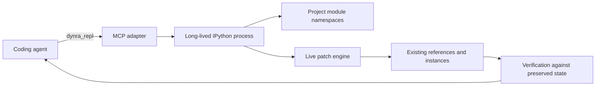

<p align="center">
  
</p>

<p align="center">
  <strong>Live Python runtime for coding agents.</strong><br>
  Inspect, patch, and verify running software without restarting the process or losing its state.
</p>

<p align="center">
  <code>Python 3.10+</code> · <code>Model Context Protocol</code> · <code>IPython</code> · <code>State-preserving patches</code>
</p>

<p align="center">
  <a href="https://github.com/antlobach/Dynra/actions/workflows/ci.yml"></a>
  <a href="https://deepwiki.com/antlobach/Dynra"></a>
</p>

## Overview

Dynra lets a coding agent develop Python software interactively inside a persistent process. The agent can navigate project modules, execute arbitrary Python in their namespaces, add or redefine functions and classes, and exercise each change immediately against the running application.

Compatible function and class identities stay stable while the software evolves. Existing imports, registries, closures, partials, and class instances can continue to refer to the patched objects.



## Capabilities

- Discovers modules from the repository root, `src/`, and configured setuptools, Poetry, or Hatch source roots.
- Lists an unloaded module's public symbols without importing it.
- Executes arbitrary Python in a selected module namespace.
- Preserves compatible function and class identities across redefinitions.
- Updates existing imported references and mutable holders.
- Migrates existing instances through an optional `__dynra_update__` hook.
- Skips registration decorators when replacing an existing decorated definition.
- Rolls back definition changes when a multi-definition evaluation fails.
- Shows, reverts, and persists live changes.

## Install and start

Clone Dynra, then install it into the target project's Python environment:

```bash
git clone https://github.com/antlobach/Dynra.git /path/to/Dynra
uv pip install --python /path/to/target-project/.venv/bin/python /path/to/Dynra
```

Start Dynra from the target project's root with that interpreter:

```bash
cd /path/to/target-project
.venv/bin/dynra
```

The working directory matters. Dynra reads the target's `pyproject.toml`, activates its source roots, and indexes its Python modules without importing them. The runtime listens on `127.0.0.1:9999` by default. Use `dynra --port PORT` to start it on another port.

## Agents

The repository includes a [Dynra agent skill](.agents/skills/dynra/SKILL.md). Give that skill to an agent that can call the MCP server. It defines the live-development loop, patching constraints, failure handling, and the point at which a verified live change should become a source edit.

Configure the MCP adapter in an MCP-compatible coding agent, replacing the repository path:

```json
{
  "mcpServers": {
    "dynra": {
      "command": "uv",
      "args": [
        "--directory",
        "/absolute/path/to/Dynra",
        "run",
        "python",
        "dynra_mcp.py"
      ]
    }
  }
}
```

The adapter exposes one tool:

```text
dynra_repl(code, module="user", create=False, port=9999)
```

`port` selects an existing long-running Dynra/IPython process on `127.0.0.1`; it does not start a new process. The value must match the runtime's `dynra --port PORT` option. `module` selects the namespace before evaluation. Imports are strict, so missing modules and import-time failures return errors. Set `create=True` only for an intentional synthetic scratch module. Every response contains `success`, `module`, `result`, `stdout`, `stderr`, `error`, `generation`, and `source_sync`.

### Agent workflow

1. Discover the project's modules without importing them.
2. Enter a module and inspect its live namespace.
3. Execute focused expressions to explore behavior or build the next increment.
4. Add or redefine a complete function or class in its owning module.
5. Exercise the change through a real consumer while process state remains alive.
6. Inspect the live-versus-disk diff.
7. Persist the definition or apply the equivalent source edit, then run the project's durable checks.

Example:

```text
dynra_repl(code="ls_md()")
dynra_repl(code="dir_md('shop.pricing')")

dynra_repl(
  module="shop.pricing",
  code="source(calculate_total)",
)

dynra_repl(
  module="shop.pricing",
  code="def calculate_total(cart):\n    return sum(item.price * item.quantity for item in cart)",
)

dynra_repl(
  module="shop.checkout",
  code="active_checkout.total()",
  port=9999,
)

dynra_repl(
  module="shop.pricing",
  code="source_patch()",
)
```

A successful live patch proves the behavior in the current process. It does not replace source control or the project's test suite.

## Namespace model

Dynra starts in a synthetic `user` namespace. Use the `module` argument on `dynra_repl` for atomic namespace selection. Within the REPL, these commands manage namespaces:

- `require_md(name)` imports a real module and preserves the original import failure.
- `create_md(name)` creates a synthetic namespace without entering it.
- `in_md(name)` enters an existing real or synthetic namespace.
- `ls_md()` separates discovered, loaded-project, synthetic, and external modules.
- `dir_md(name)` statically inspects an unloaded project module or lists a loaded module.

Dynra supplies its commands through REPL builtins. It does not add those names to application module globals.

## Source healing

Before each module-scoped evaluation, Dynra checks that module's source-file signature. The clean path performs one metadata check. Dynra parses a file only after its signature changes.

External edits to top-level functions and classes are applied automatically to the existing live objects. Prior imports and compatible instances therefore receive the new behavior without module reloads. Added definitions are evaluated in the live namespace. Deleted definitions are removed from the owning module and direct module imports. Each healed batch increments the module generation and appears in the response's `source_sync` field.

A module can repair derived state through an opt-in hook:

```python
def __dynra_reconcile__(changes):
    if any(change[\"definition\"].endswith(\".build_routes\") for change in changes):
        rebuild_routes_in_place()
```

Dynra does not rerun arbitrary assignments, imports, or top-level side effects. Constants and copied values retain normal Python semantics. If both disk and the REPL changed the same definition, Dynra keeps the live definition and reports a conflict instead of guessing. `persist_source()` uses the captured base definition and refuses to overwrite an external edit.

## Live patch model

Remote code executes one top-level statement at a time. After each function or class definition, Dynra reconciles the new object with the live object:

- Safe function mode refuses incompatible closure layouts and sync/async changes when old objects still have direct holders.
- Safe class mode refuses incompatible metaclass, base-class, and `__slots__` changes.
- Existing decorated definitions retain their registration because Dynra does not rerun their decorators.
- A multi-definition request restores changed definitions if a definition is refused or evaluation fails.

Transactions cover definition changes. They cannot undo arbitrary external side effects from ordinary statements or a first-time decorator. Native extension state, process configuration, and incompatible object layouts can still require a restart.

### Evolving existing instances

Add `__dynra_update__` when a compatible class patch needs to initialize state on existing instances:

```python
class Session:
    def __init__(self, user):
        self.user = user

    def label(self):
        return f"{self.user}:{self.status}"

    def __dynra_update__(self):
        if not hasattr(self, "status"):
            self.status = "active"
```

After the patch, existing `Session` instances use the new methods and run `__dynra_update__`.

## Runtime commands

| Command | Purpose |
| --- | --- |
| `create_md(name)` | Create a synthetic scratch module. |
| `require_md(name)` | Import a real module and surface its complete import error. |
| `in_md(name)` | Enter an existing real or synthetic module. |
| `ls_md()` | List discovered, loaded-project, synthetic, and external modules. |
| `dir_md(module=None)` | List symbols, including static inspection of unloaded project modules. |
| `doc(obj)` / `source(obj)` | Show documentation or live source. |
| `find_var(pattern)` | Search loaded modules for matching symbol names. |
| `function_patch_mode(mode=None)` | Read or set `safe` or `permissive` function patching. |
| `class_patch_mode(mode=None)` | Read or set `safe` or `permissive` class patching. |
| `unmap(name)` | Delete a binding and report remaining direct holders. |
| `patch_log()` | Show applied, refused, reverted, and persisted operations. |
| `revert(target)` / `revert_all()` | Restore one or all live definition snapshots. |
| `diverged()` / `source_patch()` | Show unified diffs between live definitions and source files. |
| `persist_source(target=None)` | Write exact evaluated definitions to their project source files. |
| `source_sync_status(module=None)` | Show source freshness, conflicts, live definitions, and generation. |
| `help_dynra()` | Show runtime help. |

## Terminal client

The interactive runtime accepts normal IPython input. `dynra_client.py` sends a one-off evaluation to an existing runtime:

```bash
python /path/to/Dynra/dynra_client.py --module package.module "expression"
python /path/to/Dynra/dynra_client.py --module scratch --create "value = 1"
```

## Security

Dynra executes arbitrary Python by design. Use it only for trusted local development. Do not expose its TCP port to untrusted networks, and do not grant untrusted agents access to the MCP server.

## Development

```bash
uv sync --frozen --group dev
uv run pytest -q
uv build
```

CI runs the test suite on Python 3.10 through 3.14 and builds the package.

## License

Dynra is licensed under the [Apache License 2.0](LICENSE).
