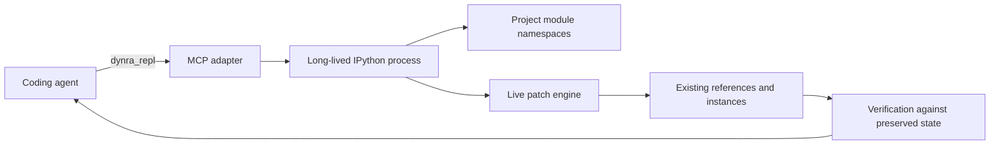

<p align="center">
  
</p>

<p align="center">
  <strong>Live Python runtime for coding agents.</strong><br>
  Inspect, patch, and verify running software without restarting the process or losing its state.
</p>

<p align="center">
  <a href="https://github.com/antlobach/Dynra/actions/workflows/ci.yml"></a>
  <a href="https://github.com/antlobach/Dynra/actions/workflows/ci.yml"></a>
  
  <a href="https://pypi.org/project/dynra/"></a>
  <a href="LICENSE"></a>
  <a href="https://deepwiki.com/antlobach/Dynra"></a>
</p>

## Overview

Dynra lets a coding agent develop Python software interactively inside a persistent process. The agent can navigate project modules, execute arbitrary Python in their namespaces, add or redefine functions and classes, and exercise each change immediately against the running application.

Compatible function and class identities stay stable while the software evolves. Existing imports, registries, closures, partials, and class instances can continue to refer to the patched objects.



## Capabilities

- Discovers modules from the repository root, `src/`, and configured setuptools, Poetry, or Hatch source roots.
- Lists an unloaded module's public symbols without importing it.
- Executes arbitrary Python in a selected module namespace.
- Preserves compatible function and class identities across redefinitions.
- Updates existing imported references and mutable holders.
- Migrates existing instances through an optional `__dynra_update__` hook.
- Skips registration decorators when replacing an existing decorated definition.
- Rolls back definition changes when a multi-definition evaluation fails.
- Shows, reverts, and persists live changes.

## Install and start

Add Dynra as a development dependency of the target project:

```bash
cd /path/to/target-project
uv add --dev dynra
```

Start Dynra from the target project's root:

```bash
uv run dynra
```

Dynra runs in the target project's virtual environment, so project dependencies
are importable. It reads the target's `pyproject.toml`, activates its source
roots, and indexes its Python modules without importing them. Dynra does not
start the application; import or bootstrap the application explicitly when its
live state is needed. The runtime listens on `127.0.0.1:9999` by default. Use
`uv run dynra --port PORT` to select another port.

Each runtime registers its identity, project root, process, interpreter, and
endpoint in the local Dynra registry after its socket is ready. Manage running
runtimes without scanning ports:

```bash
dynra list
dynra status RUNTIME_ID
dynra stop RUNTIME_ID
dynra clean
```

`status` and `stop` also accept an unambiguous port or project path. `clean`
validates registered processes against the Dynra handshake and removes stale
records. Set `DYNRA_RUNTIME_DIR` to override the registry location.

### Explicit project bootstrap

Dynra never starts the application automatically. A project can declare an
optional module or callable that developers invoke explicitly:

```toml
[tool.dynra]
bootstrap = "dev.dynra:bootstrap"
```

```python
def bootstrap(namespace):
    service = create_development_service()
    namespace["service"] = service
    return {"client": service.test_client()}
```

Run it inside Dynra with `bootstrap()`. The callable receives the persistent
`user` namespace and may mutate it or return a mapping of names to add.
Successful bootstraps run once unless `bootstrap(force=True)` is requested.
`bootstrap_status()` reports configuration, attempts, completion, and exports.

## Agents

The repository includes a [Dynra agent skill](.agents/skills/dynra/SKILL.md). Give that skill to an agent that can call the MCP server. It defines the live-development loop, patching constraints, failure handling, and the point at which a verified live change should become a source edit.

In a project-local MCP configuration, run the installed adapter through the
project environment:

```json
{
  "mcpServers": {
    "dynra": {
      "command": "uv",
      "args": ["run", "dynra-mcp"]
    }
  }
}
```

The MCP client must launch this command with the target project as its working
directory. If the configuration is global, set its supported `cwd` option to
the target project. Start `uv run dynra` separately before using the tool.

The adapter exposes structured tools for discovery and routine operations:

```text
dynra_runtimes()
dynra_status(runtime="", port=9999)
dynra_modules(runtime="", port=9999)
dynra_symbols(module, runtime="", port=9999)
dynra_source(target, runtime="", port=9999)
dynra_evaluate(code, module="user", create=False, runtime="", port=9999)
dynra_diff(runtime="", port=9999)
dynra_persist(target="", runtime="", port=9999)
dynra_revert(target, runtime="", port=9999)
dynra_patch_log(runtime="", port=9999)
dynra_events(after=0, limit=None, runtime="", port=9999)
dynra_bootstrap(force=False, runtime="", port=9999)
dynra_bootstrap_status(runtime="", port=9999)
dynra_lifecycle_plan(definitions, runtime="", port=9999)
dynra_lifecycle_reconcile(definitions, source_before={}, source_after={}, runtime="", port=9999)
dynra_lifecycle_journal(runtime="", port=9999)
```

`runtime` accepts a runtime ID, unambiguous project path, or registered port.
The compatibility tool
`dynra_repl(code, module="user", create=False, port=9999)` remains available.
It selects an existing runtime by port and does not start a process. Imports are
strict, and `create=True` is only for intentional synthetic namespaces.

### Fully interactive agent workflow

Use the structured tools by default. They return machine-readable values and
avoid spending evaluations on command plumbing. Use `dynra_evaluate` for
arbitrary expressions and complete definition replacements; keep `dynra_repl`
only for clients that have not migrated to runtime discovery.

| Need | Tool | Rule |
| --- | --- | --- |
| Find a running project | `dynra_runtimes` | Select by runtime ID or unambiguous project path; never guess or scan ports. |
| Check identity and freshness | `dynra_status` | Confirm project root and inspect generation/source state before mutation. |
| Browse without importing | `dynra_modules`, `dynra_symbols` | Discover first; imports can start application code or side effects. |
| Inspect implementation | `dynra_source` | Use a qualified top-level function or class. |
| Start project-owned live state | `dynra_bootstrap_status`, then `dynra_bootstrap` | Bootstrap only when the task needs application state; Dynra never does this automatically. |
| Explore or patch | `dynra_evaluate` | Select the owning module and send focused expressions or complete top-level definitions. |
| Review live changes | `dynra_diff`, `dynra_events`, `dynra_patch_log` | Use events with a saved sequence cursor for incremental observation. |
| Undo or save | `dynra_revert`, `dynra_persist` | Revert failed hypotheses; persist only behavior verified through a real consumer. |
| Change managed resources | `dynra_lifecycle_plan` before `dynra_lifecycle_reconcile` | Reconcile only a safe plan. A refusal means restart or install/configure an adapter. |
| Diagnose interrupted lifecycle work | `dynra_lifecycle_journal` | Read swap, compensation, cleanup, and recovery state before another mutation. |

Recommended loop:

1. Call `dynra_runtimes`, choose the target, and pin its runtime ID for every
   subsequent call.
2. Call `dynra_status`, `dynra_modules`, and `dynra_symbols` to establish the
   runtime and owning module without speculative imports.
3. If live application resources are required, inspect
   `dynra_bootstrap_status`; call `dynra_bootstrap` once. Do not bootstrap for
   static inspection or pure definition work.
4. Read the current implementation with `dynra_source`, then reproduce the
   behavior through the real loaded caller with `dynra_evaluate`.
5. Replace one complete top-level function or class in its owning module.
   Keep safe patch modes enabled. For multiple definitions, send one request
   only when they form a required atomic unit.
6. Exercise the changed behavior through existing instances, imports,
   registries, routes, or callbacks—not only by directly calling the new
   definition.
7. Inspect `source_sync` on every response. Stop on `conflict`, `error`, or
   `restart-required`. Use `dynra_events(after=CURSOR)` to observe only work
   performed since the last checkpoint.
8. If managed components or tasks are affected, request
   `dynra_lifecycle_plan`. Reconcile only when `safe` is true and
   `requires_process_restart` is false. Never suppress unmanaged-holder or
   missing-lifecycle refusals.
9. Review `dynra_diff`. Revert an unsuccessful idea or persist the exact proven
   definition. Then apply any remaining ordinary source/configuration edits.
10. Run the project's durable checks. Live success proves the current process;
    source control and tests prove the deliverable.

Example:

```text
dynra_runtimes()
dynra_status(runtime="RUNTIME_ID")
dynra_symbols(module="shop.pricing", runtime="RUNTIME_ID")
dynra_source(target="shop.pricing.calculate_total", runtime="RUNTIME_ID")
dynra_evaluate(
  module="shop.pricing",
  code="def calculate_total(cart):\n    return sum(item.price * item.quantity for item in cart)",
  runtime="RUNTIME_ID",
)
dynra_evaluate(
  module="shop.checkout",
  code="active_checkout.total()",
  runtime="RUNTIME_ID",
)
dynra_diff(runtime="RUNTIME_ID")
dynra_persist(target="shop.pricing.calculate_total", runtime="RUNTIME_ID")
```

A successful live patch proves behavior in that process. It does not replace
source control or the project's test suite.

## Namespace model

Dynra starts in a synthetic `user` namespace. Use the `module` argument on `dynra_repl` for atomic namespace selection. Within the REPL, these commands manage namespaces:

- `require_md(name)` imports a real module and preserves the original import failure.
- `create_md(name)` creates a synthetic namespace without entering it.
- `in_md(name)` enters an existing real or synthetic namespace.
- `ls_md()` separates discovered, loaded-project, synthetic, and external modules.
- `dir_md(name)` statically inspects an unloaded project module or lists a loaded module.

Dynra supplies its commands through REPL builtins. It does not add those names to application module globals.

## Source healing

Before each evaluation, Dynra checks the source-file signatures of tracked project modules. The clean path performs metadata checks only. Dynra parses a file after its signature changes.

External edits to top-level functions and classes are applied automatically to the existing live objects. Prior imports and compatible instances therefore receive the new behavior without module reloads. Added definitions are evaluated in the live namespace. Deleted definitions are removed from the owning module and direct module imports. Each healed batch increments the module generation and appears in the response's `source_sync` field.

A module can repair derived state through an opt-in hook:

```python
def __dynra_reconcile__(changes):
    if any(change[\"definition\"].endswith(\".build_routes\") for change in changes):
        rebuild_routes_in_place()
```

Dynra does not rerun arbitrary assignments, imports, decorators, or top-level side effects. To opt a literal constant into safe source healing, declare it explicitly:

```python
__dynra_reloadable__ = ("TAX_RATE", "FEATURE_ENABLED")
```

Changed declared literals are copied into the live module. Undeclared assignments retain normal Python semantics. Import changes, decorator changes, removed declared constants, and declared non-literal values produce a structured `restart-required` result; Dynra never executes them during reconciliation. If both disk and the REPL changed the same definition, Dynra keeps the live definition and reports a conflict instead of guessing. `persist_source()` uses the captured base definition and refuses to overwrite an external edit.

## Live patch model

Remote code executes one top-level statement at a time. After each function or class definition, Dynra reconciles the new object with the live object:

- Safe function mode refuses incompatible closure layouts and sync/async changes when old objects still have direct holders.
- Safe class mode refuses incompatible metaclass, base-class, and `__slots__` changes.
- Existing decorated definitions retain their registration because Dynra does not rerun their decorators.
- A multi-definition request restores changed definitions if a definition is refused or evaluation fails.

Transactions cover definition changes. They cannot undo arbitrary external side effects from ordinary statements or a first-time decorator. Native extension state, process configuration, and incompatible object layouts can still require a restart.

### Evolving existing instances

Add `__dynra_update__` when a compatible class patch needs to initialize state on existing instances:

```python
class Session:
    def __init__(self, user):
        self.user = user

    def label(self):
        return f"{self.user}:{self.status}"

    def __dynra_update__(self):
        if not hasattr(self, "status"):
            self.status = "active"
```

After the patch, existing `Session` instances use the new methods and run `__dynra_update__`.

## Runtime commands

| Command | Purpose |
| --- | --- |
| `create_md(name)` | Create a synthetic scratch module. |
| `require_md(name)` | Import a real module and surface its complete import error. |
| `in_md(name)` | Enter an existing real or synthetic module. |
| `ls_md()` | List discovered, loaded-project, synthetic, and external modules. |
| `dir_md(module=None)` | List symbols, including static inspection of unloaded project modules. |
| `doc(obj)` / `source(obj)` | Show documentation or live source. |
| `find_var(pattern)` | Search loaded modules for matching symbol names. |
| `function_patch_mode(mode=None)` | Read or set `safe` or `permissive` function patching. |
| `class_patch_mode(mode=None)` | Read or set `safe` or `permissive` class patching. |
| `unmap(name)` | Delete a binding and report remaining direct holders and qualified module aliases. |
| `patch_log()` | Show applied, refused, reverted, and persisted operations. |
| `events(after=0, limit=None)` | Read append-only structured audit events by sequence cursor. |
| `revert(target)` / `revert_all()` | Restore one or all live definition snapshots; `target` may be the live function/class object or a qualified name. |
| `diverged()` / `source_patch()` | Show unified diffs between live definitions and source files. |
| `persist_source(target=None)` | Write exact evaluated definitions to their project source files. |
| `source_sync_status(module=None)` | Show source freshness, conflicts, applied outcomes, restart-required diagnostics, live definitions, and generation. |
| `help_dynra()` | Show runtime help. |

## Terminal client

The interactive runtime accepts normal IPython input. `dynra-client` sends a one-off evaluation to an existing runtime:

```bash
dynra-client --module package.module "expression"
dynra-client --module scratch --create "value = 1"
```

## Optional lifecycle adapters

Dynra remains a development dependency. Production modules do not import Dynra,
use proxy domain values, or decorate handlers. Optional development packages
publish adapters through the `dynra.adapters` entry-point group:

```toml
[project.entry-points."dynra.adapters"]
example = "dynra_example:adapter"
```

Adapters register watched components and explicit lifecycle operations. Dynra
builds a deterministic impact plan before mutation, prepares and validates
replacements before an atomic holder swap, and compensates after post-swap
failure. Missing operations, unmanaged holders, dependency cycles, restart-only
bindings, and tasks without a compatible supervision policy are refused with
machine-readable evidence.

The adapter API is exported from `dynra`: `ComponentAdapter`, `ChangeSet`,
`LifecycleRuntime`, `ManagedHolder`, `RuntimeGraph`, `TaskSupervisor`,
`TaskPolicy`, `BindingKind`, and `migrate_instances`.

Adapters are discovered lazily when the first lifecycle plan or reconciliation
is requested. A project can opt into an unpublished or project-local adapter
without adding production imports:

```toml
[tool.dynra]
adapters = ["my_project.dev_adapter:adapter"]
```

The module must be importable from the project's development environment. The
value is a `module` or `module:attribute` target; Dynra never scans arbitrary
project modules for adapters. Install the optional Stario integration with:

```bash
uv add --dev dynra-stario
```

It preserves the loaded `stario.App`, listener, Relay, active requests,
unaffected tasks, and streams while atomically publishing rebuilt routes and
middleware. In the development bootstrap, wrap only side-effect-free route
registration in `dynra_stario.compose_routes(app, build_routes)`; the adapter
replays that function without restarting listeners, databases, or tasks. The
production bootstrap can continue to call `build_routes(app)` directly, so
removing the development dependencies does not affect application startup.
A changed running task is refused unless a Dynra `TaskSupervisor`
defines its replacement policy; Dynra never rewrites suspended coroutine frames.

Agents can inspect and operate lifecycle reconciliation without evaluating
arbitrary helper code:

```text
dynra_lifecycle_plan(definitions, runtime="", port=9999)
dynra_lifecycle_reconcile(definitions, source_before={}, source_after={}, runtime="", port=9999)
dynra_lifecycle_journal(runtime="", port=9999)
```

For a managed definition change, pass the qualified name and matching source
text in `source_before` and `source_after`. Dynra quiesces affected components,
compiles definitions into a staging namespace, and exposes candidates to
adapters as `ChangeSet.staged_definitions`. Only after every component, binding,
and gated task replacement prepares and validates does Dynra publish the
definitions and one component/binding generation. Transactions serialize per
runtime and per shared live adapter resource. Definition publication,
preparation, validation, or commit failure restores definitions and managed
resources when compensation succeeds. Cleanup runs after the new generation
commits; cleanup failure retains it and records `cleanup-incomplete`. Missing
quiescence or compensation refuses before mutation.

Affected supervised tasks use their declared `never`, `manual`, `safe-point`,
`drain`, `rolling`, or `immediate` policy. `never`, unapproved `manual`, stale
zero-argument rolling readiness, rolling replacement that depends on an
unpublished staged definition, and decorated definition reconciliation refuse
before publication. Decorator registration must live in adapter-owned
composition. Each attempted task outcome is journaled.

`dynra_lifecycle_plan` never mutates runtime state. A reconciliation rebuilds
only the affected dependency subgraph; unchanged prerequisites retain object
identity. Components and bindings become visible through one immutable
generation snapshot, so adapter code must read related values from
`LifecycleRuntime.snapshot()` rather than call separate holders across a swap.
The durable per-project journal records source hashes, preparation, task
outcomes, the atomic swap point, cleanup, compensation, and restart recovery
state. Concrete framework semantics belong in separate optional packages.

## Security

Dynra executes arbitrary Python by design. Use it only for trusted local development. Do not expose its TCP port to untrusted networks, and do not grant untrusted agents access to the MCP server.

## Development

Develop Dynra in its own environment:

```bash
git clone https://github.com/antlobach/Dynra.git
cd Dynra
uv sync --frozen --group dev
uv run pytest -q
uv build
```

To exercise an unreleased checkout from another project, install it there as an
editable development dependency:

```bash
cd /path/to/target-project
uv add --dev --editable /path/to/Dynra
uv run dynra
```

Before committing that project's dependency files, replace the local path with
the published package:

```bash
uv remove --dev dynra
uv add --dev dynra
```

CI runs the test suite on Python 3.10 through 3.14 and builds the package.

## License

Dynra is licensed under the [Apache License 2.0](LICENSE).
